# Лабораторна робота №8

## Тема, мета та опис проєкту

Тема: обробка форм, базове керування даними та збереження стану за допомогою `localStorage` і JSON.

Мета: навчитися читати й перевіряти дані форми, створювати та видаляти власні записи, повторно відображати список і відновлювати його після перезавантаження сторінки.

Опис проєкту: сайт готелю Hilton Київ (варіант 20) з лабораторних №1-7. Каталог номерів із лаби 7 лишився без змін. Додано нову секцію «Мої нотатки до поїздки»: форма з назвою, категорією й описом та список власних нотаток, які зберігаються в браузері.

## Запуск

Відкрити `index.html` через локальний HTTP-сервер (наприклад, Live Server). Для перевірки збереження потрібно щоразу відкривати сторінку за тією самою адресою й портом, бо `localStorage` прив'язаний до origin (протокол, хост і порт). Для зміни стилів: `npm install` і `npm run sass`.

## Модулі

```
js/
├── api.js          завантаження каталогу (лаба 7)
├── catalog.js      фільтр, сортування і картки каталогу (лаба 7)
├── utils.js        debounce і назви категорій
├── userItems.js    форма, список власних нотаток, додавання й видалення
├── storage.js      читання, перевірка та запис у localStorage
└── main.js         зв'язує модулі
```

- `userItems.js` експортує `initUserItems()`. Вона знаходить елементи форми за `id`, один раз реєструє обробники `submit` і `click`, малює список і викликає `storage.js`.
- `storage.js` має один ключ, `readUserItems()` і `writeUserItems()`, а також перевірку структури даних `isUserItems()`.
- `main.js` викликає `initUserItems()` один раз, незалежно від мережевої `init()` з лаби 7. Власний список не залежить від завантаження каталогу.

## Схема запису та ключ

```json
{
  "id": "user-6886b351-9259-4ab6-81ff-22201dd16d6a",
  "title": "Тихий номер на високому поверсі",
  "category": "room",
  "description": "Попросити номер подалі від ліфта, з виглядом на місто, бажано вище 10 поверху."
}
```

| Поле | Правило |
| --- | --- |
| `id` | `user-` + `crypto.randomUUID()`, створюється лише під час додавання |
| `title` | рядок, 3-80 символів після `trim()` |
| `category` | `room` (Номер), `food` (Харчування) або `leisure` (Дозвілля) |
| `description` | рядок, 10-500 символів після `trim()` |

Ключ у `localStorage`: `web-lab8:hotel-notes:v1`. У ньому лежить JSON-масив записів. Повного очищення сховища (`localStorage.clear()`) немає: за потреби видаляється лише цей ключ.

## Як це працює

**Валідація.** Поля мають `required`, `minlength`, `maxlength`, а `reportValidity()` показує вбудовані підказки браузера. Додатково після `trim()` перевіряється текст: пробіли замість назви чи опису, надто довгі рядки й невідома категорія відхиляються з зрозумілим повідомленням, а фокус переходить на проблемне поле. Дані читаються через `FormData(form)` за атрибутами `name`.

**Додавання.** Подія `submit` обробляється на формі, `preventDefault()` скасовує перезавантаження. Запис отримує `id`, масив замінюється новим (`[...userItems, record]`), список малюється без перезавантаження сторінки, форма очищується, фокус повертається на назву.

**Видалення.** Один обробник `click` на контейнері списку знаходить кнопку через `event.target.closest("[data-delete-id]")` і вилучає запис за `id`. Обробник лишається після кожної заміни карток, тому повторних обробників немає.

**Безпечний DOM.** Картки створюються через `createElement()` і `textContent`, тому текст на кшталт `<b>Мій запис</b>` показується буквально.

**Порядок відновлення.** При запуску `initUserItems()` читає сховище до першого рендерингу. Якщо ключа немає, список порожній. Якщо дані пошкоджені (неправильний JSON або неправильна структура), сторінка працює з порожнім списком і показує повідомлення, але сховище **не перезаписується** до першої явної зміни списку користувачем.

**Збереження.** Спільна функція `commit()` оновлює пам'ять та інтерфейс, а потім пробує записати масив у сховище. Якщо запис не вдався, зміна лишається в пам'яті, а користувач бачить повідомлення про те, що зміни не збережені. Після видалення останнього запису зберігається `[]`.

## Скриншоти

Форма з помилкою (пробіли замість назви):

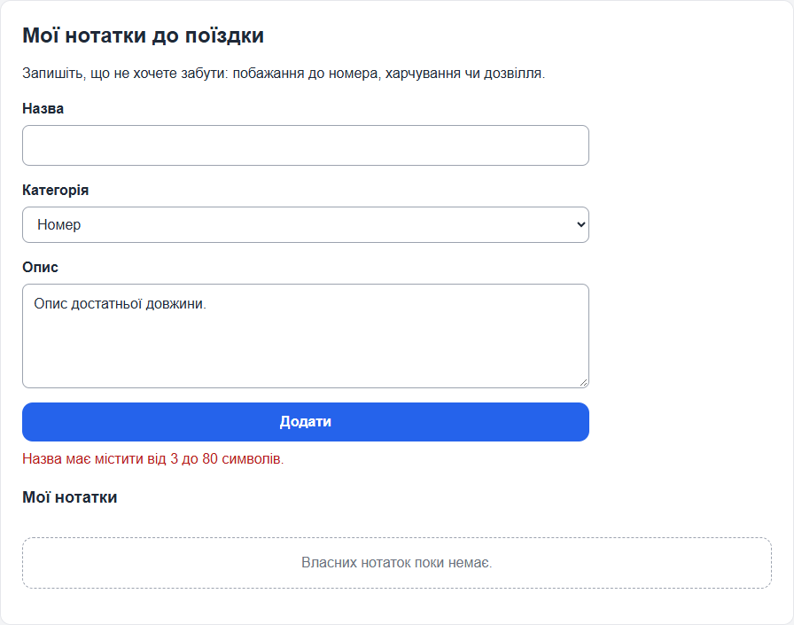

Список після перезавантаження сторінки:

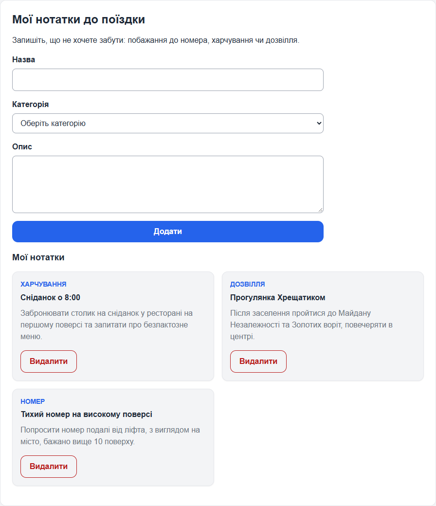

Значення в DevTools → Application → Local Storage (ключ `web-lab8:hotel-notes:v1`) має вигляд JSON-масиву з прикладу вище.

## Результати перевірок

1. Перший запуск без ключа: список порожній, показано «Власних нотаток поки немає», помилок у Console немає.
2. Порожні поля, пробіли замість назви чи опису, надто довгі або короткі значення, невибрана категорія: запис не додається, повідомлення зрозуміле, фокус на проблемному полі.
3. Додано 3 нотатки: вони з'явилися без перезавантаження з різними `id`. Після видалення одного запису видалився рівно один: обробники не дублюються.
4. Після перезавантаження за тією самою адресою нотатки та їхні `id` відновлюються, у сховищі один ключ.
5. Видалена нотатка після перезавантаження не повертається. Після видалення всіх зберігається `[]`, і список лишається порожнім.
6. Значення `{`, `{}` і `[{"id":"x"}]`: сторінка показує повідомлення і не падає, каталог працює, ключ не перезаписується до нової дії. Після нового запису ключ містить коректний масив.
7. Коли `setItem()` кидає виняток: нотатка видима в пам'яті, повідомлення попереджає, що зміни не збережені.
8. Назва `<b>Мій запис</b>` і опис з `<script>` відображаються як текст, у картці немає елементів `b`, `i` чи `script`. Після додавання й видалення фокус повертається на назву, мобільна ширина 360 і 768 px без горизонтального прокручування, поля мають `label`, повідомлення має `role="status"`.
9. Якщо `data/items.json` недоступний, каталог показує помилку з повтором, а форма і власні нотатки працюють. Після відновлення файлу повтор завантажує каталог, нотатки не змінюються.

Помилки в Console виникають лише під час навмисних перевірок 6, 7 і 9.

## Обмеження

- `localStorage` працює в межах одного origin і браузера: при зміні порту, хоста чи браузера записи не видно. Дані не синхронізуються між пристроями, і їх можна очистити.
- Редагування запису не реалізовано (необов'язкове завдання).
- Скриншот DevTools із вмістом `localStorage` не доданий, наведено лише структуру запису.

## Посилання та висновок

Pull request: https://github.com/NazariiKhavruk/lab1-hotel/pull/7

Висновок: у цій роботі я навчився обробляти форму через подію `submit` і `FormData`, перевіряти дані, створювати та видаляти власні записи й зберігати їх у `localStorage` у вигляді JSON. Зрозумів, що збережені дані теж треба перевіряти, бо вони можуть бути пошкоджені, і що збій запису не повинен ламати сторінку. Практикувався з Git: окремі коміти за форматом `type: description`.

---

# Лабораторна робота №7

## Тема, мета та опис проєкту

Тема: модульний каталог та асинхронне завантаження даних (ES Modules, `async`/`await`, замикання, чисті функції).

Мета: розвинути каталог з лабораторної №6: розділити код на модулі, завантажувати дані з JSON через `fetch()`, обробляти помилки та використати замикання для відкладеного пошуку.

Опис проєкту: сайт готелю Hilton Київ (варіант 20) з лабораторних №1-6. Тема, 8 номерів, 3 категорії, пошук, фільтр і адаптивні стилі збережені. Змінилося джерело даних (файл `data/items.json` замість масиву в коді) та організація JavaScript.

## Запуск

Сторінку потрібно відкривати через локальний HTTP-сервер (наприклад, Live Server у VS Code), а не через `file://`: модулі та `fetch()` не працюють з файлової системи. Для зміни стилів: `npm install` і `npm run sass`.

## Структура

```
lab1-hotel/
├── index.html
├── css/styles.css
├── data/items.json
├── images/
├── js/
│   ├── api.js
│   ├── catalog.js
│   ├── utils.js
│   └── main.js
└── README.md
```

| Модуль | Що робить |
| --- | --- |
| `api.js` | `loadItems()`: завантажує `items.json`, перевіряє `response.ok`, формат і кожен запис |
| `catalog.js` | `filterItems()` (чиста фільтрація), `sortItems()` (сортування стратегіями), `renderItems()` (рендеринг через DOM-вузли), `setupFavorites()` |
| `utils.js` | `debounce()` і словник назв категорій |
| `main.js` | знаходить елементи сторінки, керує станами, реєструє обробники |

`main.js` імпортує три інші модулі, вони `main.js` не імпортують. У `index.html` підключений один вхідний модуль: `<script type="module" src="js/main.js"></script>`. Взаємодії з лабораторної №5 (показати більше, лічильник гостей) перенесені в `main.js`, а кнопка «Обране» працює в `catalog.js`.

## Приклад запису JSON

```json
{
  "id": 4,
  "title": "Deluxe",
  "category": "deluxe",
  "description": "2 особи, вид на місто.",
  "image": "images/room-deluxe.jpg"
}
```

У файлі 8 записів, категорії `standard`, `deluxe`, `suite`. `loadItems()` перевіряє, що `id` є додатним цілим і не повторюється, що текстові поля непорожні, що категорія відома, а `image` є локальним шляхом до зображення (зовнішні адреси відхиляються). Порожній масив `[]` вважається коректним результатом.

## Пояснення

**async/await.** `async`-функція завжди повертає `Promise`. `await` призупиняє виконання лише цієї функції, поки не прийде результат, а інтерфейс не блокується. `fetch()` повертає `Response`, а `response.json()` асинхронно читає й розбирає JSON. Відповідь 404 або 500 для `fetch()` не є помилкою, тому статус перевіряється через `response.ok`. Помилки обробляє `try/catch/finally`: у `catch` показується повідомлення і кнопка повтору, а `finally` завжди знімає стан «Завантаження» і розблоковує елементи.

**Чиста функція.** `filterItems(items, query, category)` отримує все через аргументи, повертає новий масив і не змінює ні DOM, ні початкові об'єкти. З тими самими аргументами вона завжди дає той самий результат, тому її легко перевіряти. `renderItems()` чистою не є, бо змінює DOM. Мережа й DOM виконуються окремо як побічні ефекти.

**Замикання.** `debounce(fn, delay)` повертає функцію, яка пам'ятає змінну `timerId` між викликами. Кожне нове введення скасовує попередній таймер і запускає новий, тому пошук виконується один раз після паузи 300 мс. Це функція вищого порядку: вона приймає функцію і повертає функцію. Debounced-функція створюється один раз під час реєстрації обробника. `setTimeout` гарантує лише мінімальну затримку, а не точний момент виконання.

**Безпечний DOM.** Картки створюються через `createElement()`, `textContent` і `append()`, а не через `innerHTML`, тому текст з JSON не може стати розміткою. Список перемальовується через `replaceChildren()`.

## Додаткове завдання: Strategy для сортування

Обрано патерн Strategy: у `catalog.js` є об'єкт `sortStrategies`, де кожна стратегія це окрема функція порівняння:

```js
const sortStrategies = {
  default: (a, b) => a.id - b.id,
  "title-asc": (a, b) => a.title.localeCompare(b.title, "uk"),
  "title-desc": (a, b) => b.title.localeCompare(a.title, "uk")
};

export function sortItems(items, strategy = "default") {
  const compare = sortStrategies[strategy] ?? sortStrategies.default;
  return [...items].sort(compare);
}
```

Значення поля «Сортування» (`default`, `title-asc`, `title-desc`) вибирає стратегію за назвою. `sortItems()` сортує **копію** масиву (`[...items]`), тому початкові дані не змінюються, і це чиста функція. Невідома назва стратегії безпечно переходить на `default`.

Користь: щоб додати новий спосіб сортування (наприклад, за категорією), достатньо дописати одну функцію в `sortStrategies` і один `option` у HTML. Умов `if`/`switch` у `main.js` і самій `sortItems()` змінювати не треба. Порядок обробки такий: спочатку `filterItems()`, потім `sortItems()`, потім `renderItems()`. Кирилиця в `localeCompare("uk")` сортується перед латинкою, тому «Deluxe з балконом» стоїть перед «Deluxe King».

Сортування Я → А:

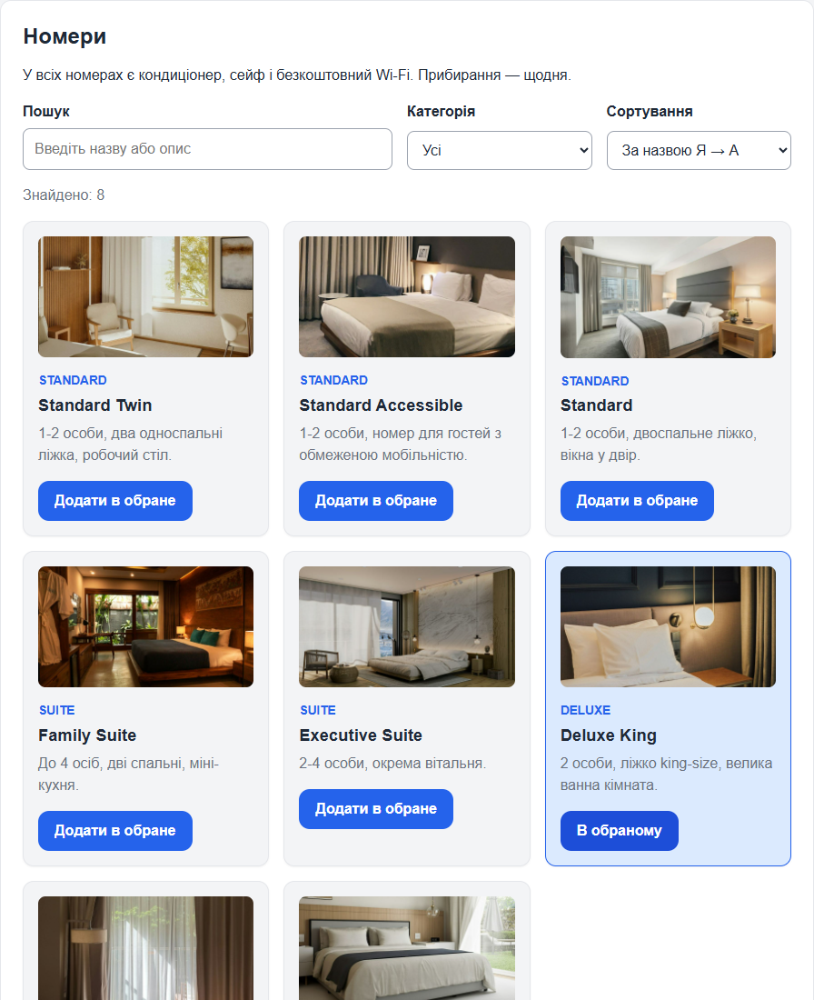

## Скриншоти

Успішне завантаження:

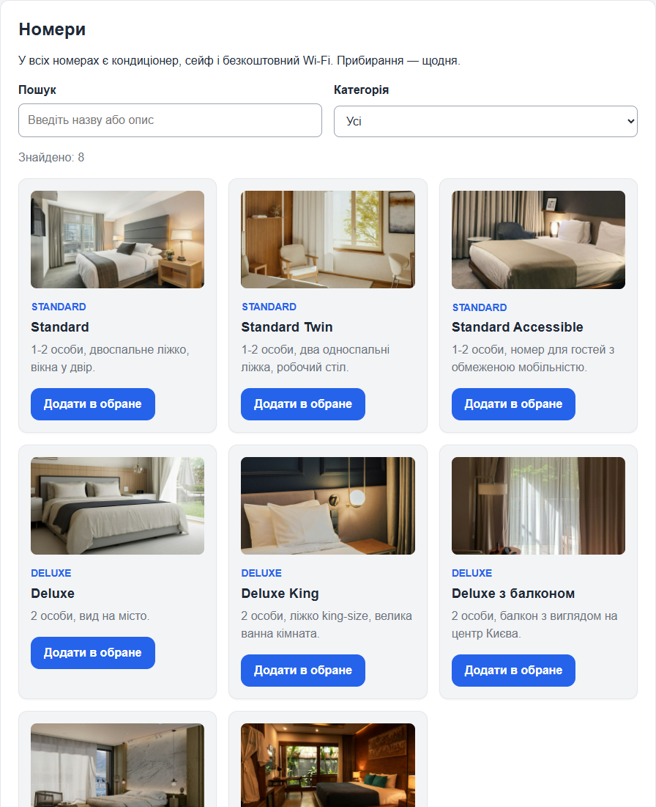

Стан завантаження (поля заблоковані, `aria-busy="true"`):

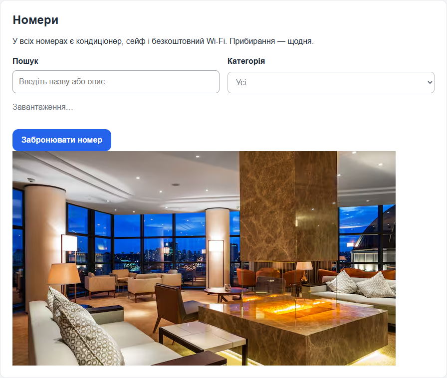

Помилка з кнопкою повтору (файл `items.json` тимчасово перейменовано):

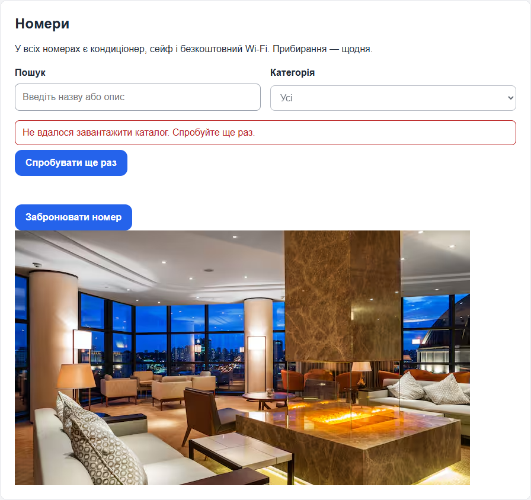

Порожній результат пошуку:

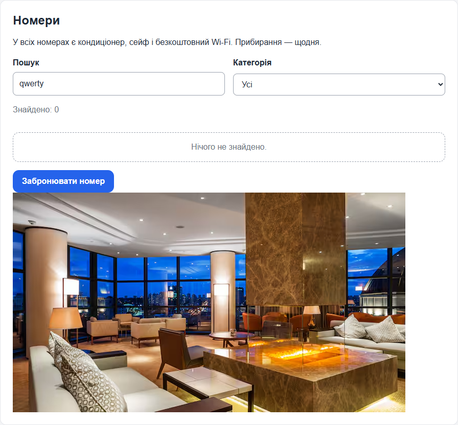

## Результати 10 перевірок

1. Через HTTP-сервер завантажуються всі 8 карток, запит `items.json` повертає 200.
2. Пошук знаходить за назвою й описом без урахування регістру (`DELUXE` знаходить 3 номери), пробіли на краях ігноруються.
3. Категорія й пошук діють разом (`4 осіб` у категорії Suite знаходить Family Suite), «Усі» й порожній пошук повертають усі 8 карток.
4. Якщо збігів немає, лічильник показує 0, контейнер порожній, з'являється «Нічого не знайдено».
5. Під час завантаження видно «Завантаження…», поля пошуку й категорії заблоковані, `aria-busy="true"`.
6. Якщо `items.json` немає, показується помилка й кнопка «Спробувати ще раз», порожній результат не показується.
7. Після відновлення файлу кнопка повтору завантажує каталог без перезавантаження сторінки і без дублювання карток (8 карток).
8. Зіпсований JSON, відсутнє поле, повторний `id`, невідома категорія, зовнішня адреса зображення та не масив дають керовану помилку з повтором. Порожній масив `[]` дає коректний порожній каталог.
9. Швидкий набір «delux» (5 символів за 300 мс) не викликає жодного рендеру під час набору й одного після паузи. Зміна категорії оновлює результат одразу.
10. Поля мають `label`, лічильник має `aria-live="polite"`, статус `role="status"`, помилка `role="alert"`, усі `id` унікальні, на ширинах 360 і 768 px горизонтального прокручування немає. Console без помилок при нормальному завантаженні. Помилки в Console з'являються лише під час навмисних перевірок помилок (пункти 6 і 8).

## Посилання та висновок

Pull request: https://github.com/NazariiKhavruk/lab1-hotel/pull/6

Висновок: у цій роботі я розділив код на ES-модулі, завантажував дані з JSON через `fetch()` з `async`/`await`, обробляв помилки через `try/catch/finally` та показував стани завантаження й помилки з повторною спробою. Зрозумів різницю між чистою функцією фільтрації та рендерингом із побічними ефектами і як замикання допомагає зробити відкладений пошук. Практикувався з Git: окремі коміти за форматом `type: description`.

---

# Лабораторна робота №6

## Тема, мета та опис проєкту

Тема: масиви та об'єкти JavaScript, динамічне формування контенту, пошук і фільтрація даних.

Мета: навчитися описувати дані масивом об'єктів, перетворювати їх на HTML-картки, оновлювати DOM і робити пошук та фільтрацію без перезавантаження сторінки.

Опис проєкту: сайт готелю Hilton Київ (варіант 20) з лабораторних №1-5. Картки номерів раніше були записані в `index.html`, тепер HTML містить лише поля керування та порожній контейнер, а картки створює JavaScript з масиву.

Запуск: відкрити `index.html` через локальний сервер (наприклад, Live Server). Щоб змінити стилі, `npm install` і `npm run sass`.

## Дані

Масив `rooms` у `js/scripts.js` містить 8 об'єктів. Кожен об'єкт описує один номер:

```js
{
  id: 4,
  title: "Deluxe",
  category: "deluxe",
  description: "2 особи, вид на місто.",
  image: "images/room.avif"
}
```

| Властивість | Призначення |
| --- | --- |
| `id` | унікальний номер, потрібен, щоб відрізняти картки |
| `title` | назва номера |
| `category` | категорія, збігається зі значенням `option` у фільтрі |
| `description` | короткий опис, по ньому теж працює пошук |
| `image` | шлях до зображення |

Категорії:

| Значення | Назва | Номери |
| --- | --- | --- |
| `standard` | Standard | Standard, Standard Twin, Standard Accessible |
| `deluxe` | Deluxe | Deluxe, Deluxe King, Deluxe з балконом |
| `suite` | Suite | Executive Suite, Family Suite |

Фото номерів узято з Unsplash (вільна ліцензія [Unsplash License](https://unsplash.com/license)), це ілюстративні фото готельних номерів, а не саме Hilton Kyiv. Автори: Point3D Commercial Imaging Ltd., Marcel Strauß, Linus Mimietz, João Emanuel, Lisha Riabinina, Hiram Huang, Nusrat Ali, visualsofdana. Фото обрізані до формату 16:9 і зменшені.

## Як це працює

- `createCard(room)` приймає один об'єкт і повертає HTML-рядок картки через шаблонний рядок із `${...}`.
- `renderRooms(roomsToRender)` перетворює масив на картки методом `map(createCard)`, з'єднує їх через `join("")` і записує в контейнер `#room-grid`. Також оновлює лічильник «Знайдено» та показує або ховає повідомлення «Нічого не знайдено».
- `applyFilters()` читає текст пошуку та категорію, залишає потрібні номери методом `filter()` і передає результат у `renderRooms()`. Пошук і категорія в одній функції, тому діють одночасно. `trim()` прибирає зайві пробіли, `toLowerCase()` прибирає різницю регістрів, `includes()` перевіряє входження тексту в назву та опис.
- Обробники: `input` на полі пошуку і `change` на списку категорій викликають `applyFilters()`.

Кнопка «Додати в обране» з лаби 5 лишилась на кожній картці. Оскільки картки створюються заново, обробник повішено на контейнер (`grid`) і шукає кнопку через `event.target.closest()`. Обрані номери запам'ятовуються в `Set`, тому після пошуку вони лишаються обраними.

## Скриншоти

Усі картки:

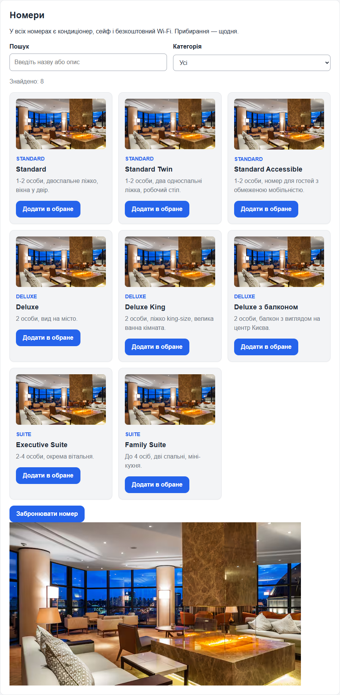

Результат пошуку («вид на місто»):

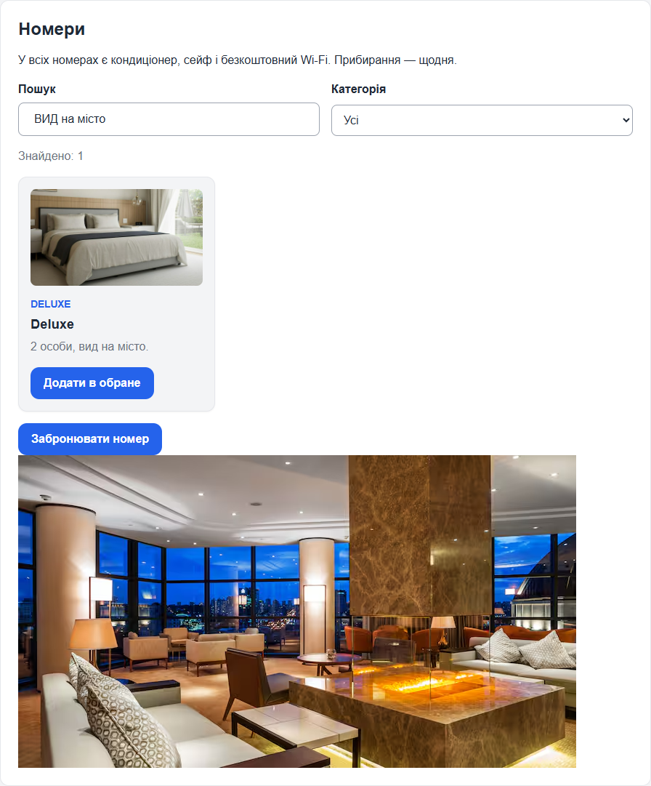

Порожній результат:


## Перевірені сценарії

- Після завантаження показано 8 карток.
- Пошук працює без урахування регістру (`DELUXE` знаходить три номери) і по назві, і по опису.
- Зайві пробіли в пошуку не заважають.
- Вибір категорії залишає лише номери цієї категорії.
- Пошук звужує вже вибрану категорію (`4 осіб` у `Suite` знаходить Family Suite).
- Очищення пошуку й вибір «Усі» повертають повний список.
- Якщо збігів немає, показано «Нічого не знайдено».
- Взаємодії з лаби 5 (показати більше, лічильник гостей, обране) працюють.
- У Console немає помилок, на ширинах 360 і 768 px горизонтального прокручування немає.

## Обмеження

- `innerHTML` використано лише для масиву, який написано в коді. Дані користувача через нього не підставляються.
- Фото номерів ілюстративні, це не реальні номери Hilton Kyiv.
- Стан не зберігається після перезавантаження сторінки.

## Посилання та висновок

Pull request: https://github.com/NazariiKhavruk/lab1-hotel/pull/5

Висновок: у цій роботі я навчився зберігати дані масивом об'єктів, створювати картки за шаблонним рядком, використовувати `map()` і `filter()` та оновлювати DOM після пошуку й фільтрації. Зрозумів схему «дані → фільтрація → рендеринг → DOM». Практикувався з Git: окремі коміти за форматом `type: description`.

---

# Лабораторна робота №5

## Тема, мета та опис проєкту

Тема: основи JavaScript, взаємодія з DOM та подіями.

Мета: навчитися підключати зовнішній JavaScript-файл, знаходити наявні HTML-елементи, реагувати на дії користувача та змінювати класи й текстовий вміст елементів.

Опис проєкту: сайт готелю Hilton Київ (варіант 20) з лабораторних №1-4. Дизайн і структура не змінились, сторінка отримала три прості інтерактивні можливості.

## Реалізовані взаємодії

| Взаємодія | Що робить | Клас стану | ARIA |
| --- | --- | --- | --- |
| Показати більше | Кнопка в розділі «Про готель» відкриває і ховає додатковий блок, текст кнопки змінюється між «Показати більше» і «Приховати» | `is-hidden` | `aria-expanded`, `aria-controls` |
| Обране | Кнопка на картці Deluxe перемикає стан «Додати в обране» / «В обраному», кнопка і картка підсвічуються | `is-active` | `aria-pressed` |
| Лічильник гостей | Кнопки «−» і «+» біля поля кількості гостей у формі змінюють значення від 1 до 4, на межі кнопка стає неактивною | `disabled` | `aria-label` |

Усі кнопки мають `type="button"`, тому не надсилають форму. Вигляд змінюється лише через CSS-класи, inline-стилі в JavaScript не використовуються. Збереження після перезавантаження не потрібне і не реалізоване.

## Використані DOM-методи та події

- `document.querySelector()`: пошук кнопок, блоку і поля форми.
- `element.closest()`: пошук картки, у якій лежить кнопка «Обране».
- `addEventListener("click", ...)` для кнопок і `addEventListener("input", ...)` для поля кількості гостей.
- `classList.toggle()`: перемикання `is-hidden` та `is-active`.
- `textContent`: зміна тексту кнопок.
- `setAttribute()`: оновлення `aria-expanded` і `aria-pressed`.

Скрипт знаходиться в `js/main.js` і підключений у кінці `index.html` з атрибутом `defer`.

## Структура проєкту

```
lab1-hotel/
├── css/
│   └── styles.css
├── images/
├── js/
│   └── main.js
├── scss/
├── index.html
└── README.md
```

## Скриншоти

Показати більше: закритий і відкритий стан:

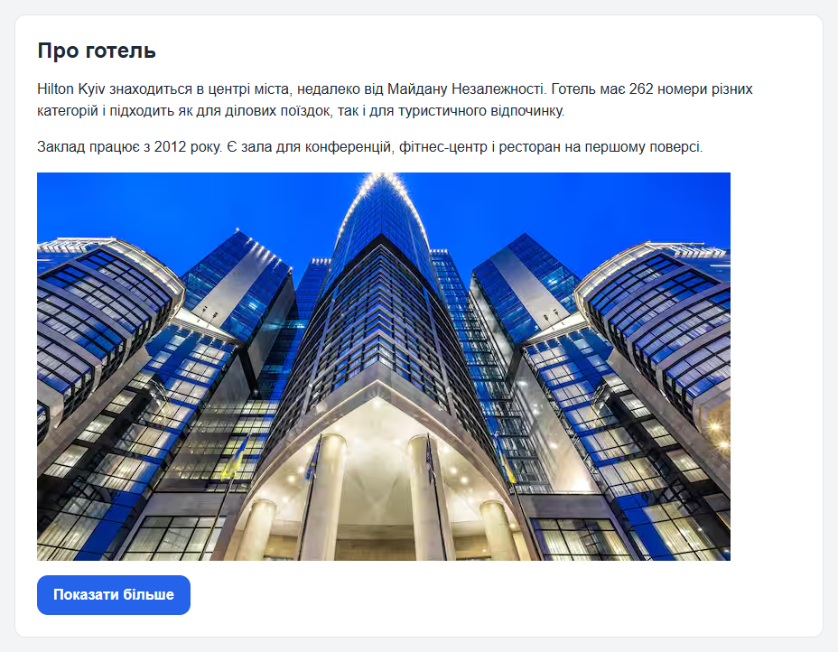

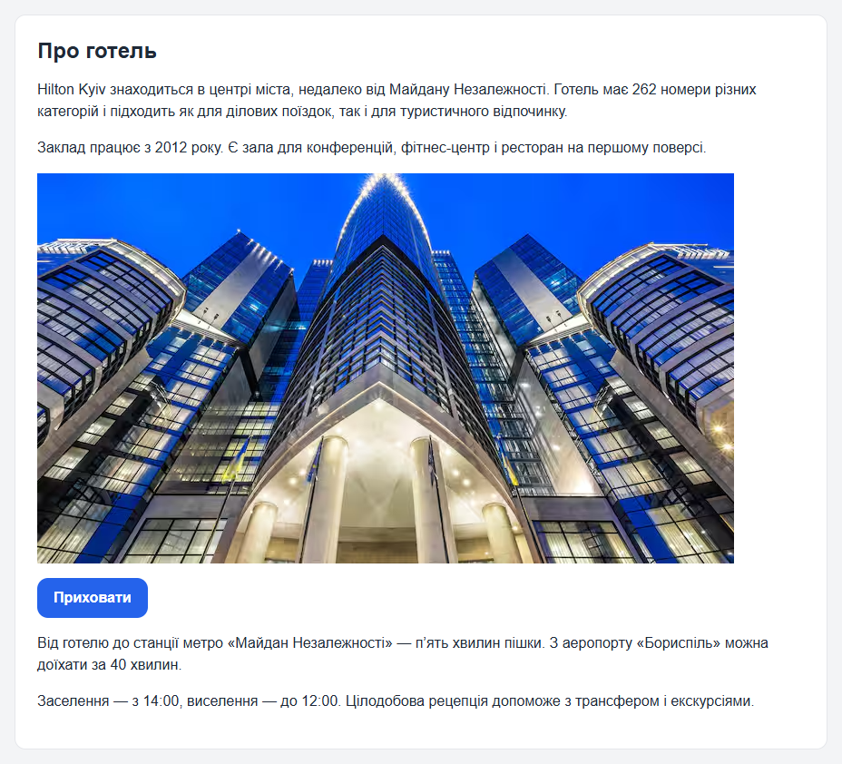

Обране:

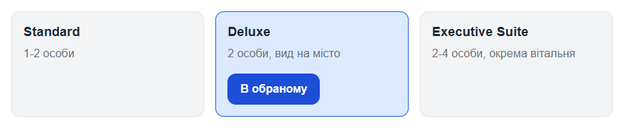

Лічильник гостей (максимум 4, кнопка «+» неактивна):

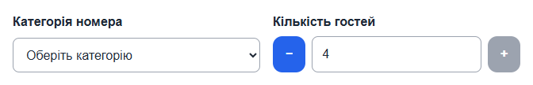

Мобільна ширина 360 px:

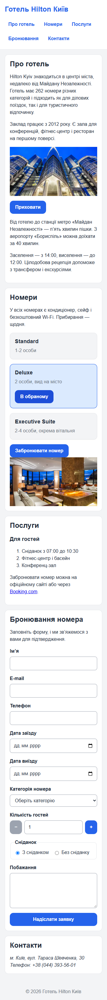

## Результати перевірки

- У Console немає помилок і попереджень від мого коду.
- Кожна дія працює після повторних натискань і повертається у початковий стан.
- Кнопки доступні з клавіатури (Tab, Enter, пробіл), рамка фокуса `:focus-visible` залишилась.
- `aria-expanded` і `aria-pressed` відповідають фактичному стану.
- На ширинах 360 і 768 px горизонтального прокручування немає, взаємодії працюють.

## Посилання та висновок

Pull request: https://github.com/NazariiKhavruk/lab1-hotel/pull/3

Висновок: у цій роботі я навчився підключати зовнішній скрипт з `defer`, знаходити елементи через `querySelector()`, обробляти події через `addEventListener()` та змінювати інтерфейс через `classList` і `textContent`. Також побачив, навіщо кнопкам `aria-expanded` і `aria-pressed`. Практикувався з Git: окремі коміти за форматом `type: description`.

---

# Лабораторна робота №4

## Тема, мета та опис проєкту

Тема: препроцесор SCSS та адаптивний дизайн веб-сторінки.

Мета: навчитися організовувати стилі в SCSS (змінні, вкладеність, міксини, модулі), компілювати їх у CSS і зробити так, щоб сторінка добре виглядала на телефоні, планшеті та комп'ютері.

Опис проєкту: сайт готелю Hilton Київ (варіант 20) з лабораторних №1-3. HTML, картки та форма залишились без змін, я переніс стилі в SCSS і додав адаптивність.

## Структура SCSS

```
scss/
├── _variables.scss
├── _mixins.scss
└── main.scss
```

- `_variables.scss`: змінні для кольорів (`$color-primary`, `$color-text`, `$color-border` та інші), відступів (`$space-md`, `$space-lg`), заокруглень (`$radius-sm`, `$radius-md`) і точок переходу (`$bp-tablet`, `$bp-desktop`).
- `_mixins.scss`: міксин `respond-from($breakpoint)` з параметром, який обгортає стилі в `@media (min-width: ...)`, і міксин `focus-ring` для видимої рамки фокуса.
- `main.scss`: усі стилі сторінки. Файли підключені через `@use "variables" as v;` та `@use "mixins" as m;`, без `@import`.
- Вкладеність використана в `.main-nav` (посилання `a` зі станами `&:hover` і `&:focus-visible`), `.site-header`, `.button`, `.form-field` та інших компонентах. Глибше двох рівнів не вкладав.

## Команди

Встановити залежності (один раз):

```
npm install
```

Скомпілювати SCSS у CSS і стежити за змінами:

```
npm run sass
```

Одноразова збірка:

```
npm run build
```

Результат записується в `css/styles.css`, який підключений в `index.html`. Скомпільований CSS вручну я не редагував.

## Mobile-first і точки переходу

Базові стилі написані для малого екрана, потім `min-width` поступово розширює макет:

| Точка | Ширина | Що змінюється |
| --- | --- | --- |
| базові стилі | до 768 px | картки в одну колонку, шапка стовпчиком, поля форми одне під одним, менші відступи |
| `$bp-tablet` | від 48rem (768 px) | картки в 2 колонки, шапка в один рядок, поля форми по два в ряд, відступи більші |
| `$bp-desktop` | від 64rem (1024 px) | картки в 3 колонки |

На великих екранах ширина контенту обмежена (`max-width: 60rem`). Точки вибрав за стандартом 768 і 1024 px, бо на цих ширинах картки і форма перестають зручно вміщатися в поточну кількість колонок.

## Скриншоти

360 px:


768 px:


1280 px:


## Результати перевірки

- На ширинах 360, 768 і 1280 px горизонтального прокручування немає (перевірив у DevTools).
- Картки: 1 колонка на 360 px, 2 на 768 px, 3 на 1280 px.
- Меню переноситься на малому екрані, поля форми займають всю ширину.
- Форма працює як раніше: обов'язкові поля, перевірка e-mail, телефона та кількості гостей.
- Навігацію і форму пройшов клавішею Tab: рамка фокуса видима.

## Посилання та висновок

Висновок: у цій роботі я навчився користуватись SCSS: змінними, вкладеністю, міксинами та поділом на файли. Також навчився компілювати SCSS у CSS і робити адаптивний макет за підходом mobile-first. Практикувався з Git: окремі коміти за форматом `type: description`.

---

# Лабораторна робота №3

## Тема, мета та опис проєкту

Тема: компонування веб-сторінки засобами CSS Flexbox і Grid, створення HTML-форми.

Мета: навчитися вибирати Flexbox або Grid для розміщення елементів, керувати вирівнюванням і проміжками, зробити форму з підписами та вбудованою HTML-перевіркою.

Опис проєкту: сайт готелю Hilton Київ (варіант 20) з лабораторних №1 і №2. Тут я покращив розміщення блоків і додав форму бронювання номера.

## Компонування сторінки

- Flexbox використано для шапки (назва зліва, меню справа, `justify-content: space-between`), для меню (`flex-wrap` і `gap`) та для групи радіокнопок у формі. У всіх трьох випадках елементи йдуть в один ряд, тому Flexbox підходить краще.
- Grid використано для карток номерів: `grid-template-columns: repeat(3, minmax(0, 1fr))` і `gap`. Також Grid використано для самої форми і для рядків з двома полями поруч (дати, e-mail і телефон, категорія і кількість гостей).
- Медіазапити, SCSS і JavaScript не використовувались.

## Форма та перевірка даних

Форма бронювання має такі поля, у кожного є `id`, `name` і `label` з `for`:

| Поле | Тип | Правила перевірки |
| --- | --- | --- |
| Ім’я | text | `required`, `minlength="2"` |
| E-mail | email | `required`, перевірка формату |
| Телефон | tel | `required`, `pattern` |
| Дата заїзду та виїзду | date | `required` |
| Категорія номера | select | `required` |
| Кількість гостей | number | `required`, `min="1"`, `max="4"` |
| Сніданок | radio у `fieldset` з `legend` | вибір за замовчуванням |
| Побажання | textarea | `maxlength="500"` |

Стани: у кнопки є `:hover`, у всіх полів `:focus-visible` з помітною рамкою, а поля з помилкою під час введення отримують червону рамку через `:focus:invalid`.

## Структура проєкту

```
lab1-hotel/
├── css/
│   └── styles.css
├── images/
├── index.html
└── README.md
```

## Результат

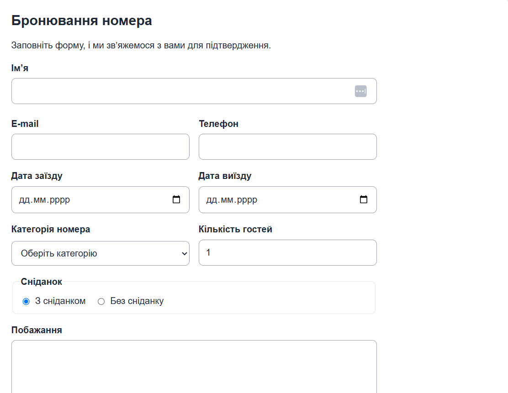

## Посилання та висновок

Pull request: (посилання буде після створення)

Висновок: у цій роботі я навчився використовувати Flexbox для рядків і Grid для сіток та форми, зробив форму з підписами та HTML-перевіркою і перевірив її клавішею Tab. Також практикувався з Git: окремі коміти за формат `type: description`.
