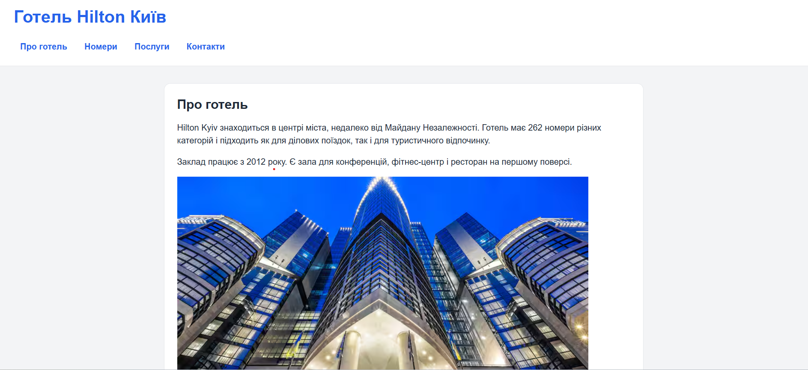
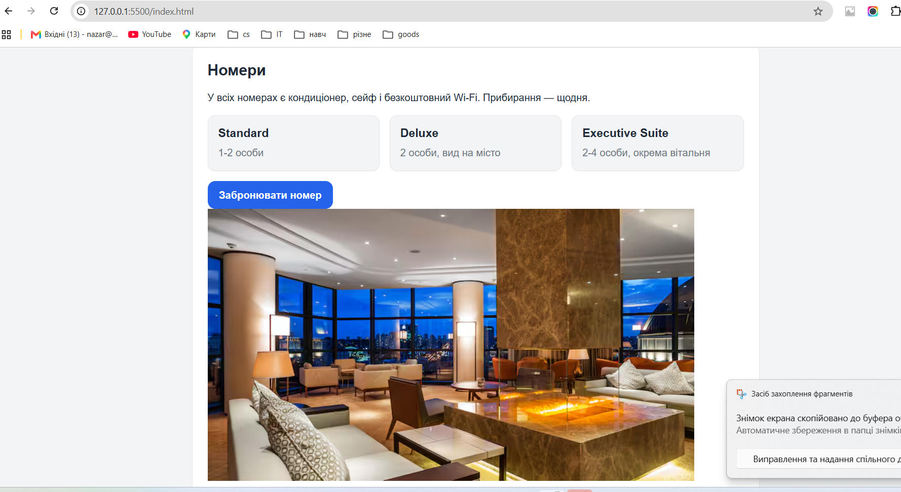
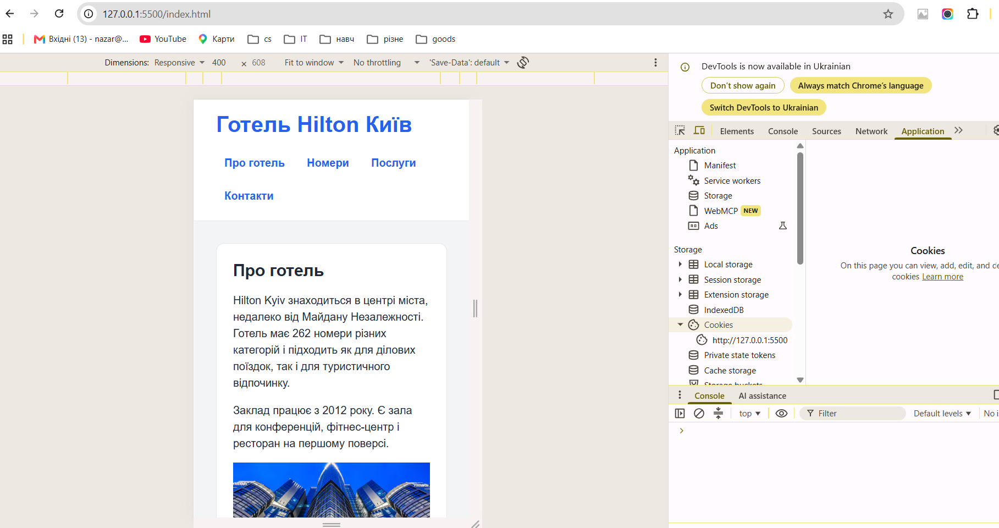
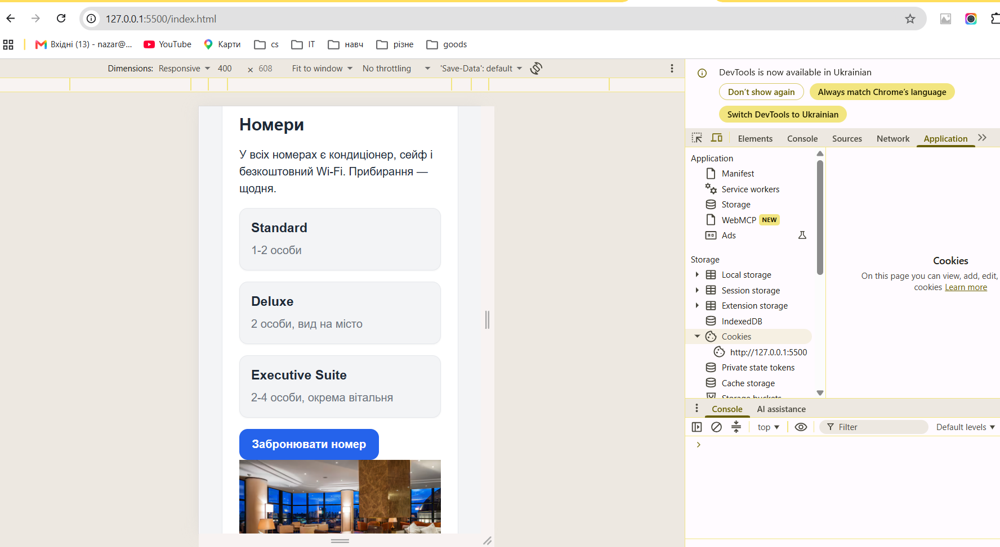

Лабораторна робота №2

Тема: Стилізація веб-сторінки засобами CSS.

Мета: навчитися підключати CSS-файл до сторінки і оформлювати її: шрифти, навігацію, кнопку та картки.

Опис проєкту: сайт готелю Hilton Київ (варіант 20) з лабораторної №1. Тут я додав до нього оформлення через CSS

Що я зробив

Створив файл css/styles.css і підключив його в index.html.

Перейменував папку img на images і змінив шляхи до картинок у HTML.

Додав класи до частин сторінки: site-header, main-nav, content, section, site-footer, button, card.

Зробив CSS-змінні в :root (кольори, відступ, заокруглення).

Оформив шапку, меню, кнопку "Забронювати номер" і три картки номерів.

Результат

Версія для комп'ютера:

Версія для телефона:

Посилання та висновок

Pull request: (додам після створення)

Висновок: у цій роботі я навчився підключати CSS до сторінки, користуватися класами і змінними, оформлювати меню, кнопку та картки. Також попрактикувався з Git: окрема гілка, кілька комітів і pull request.