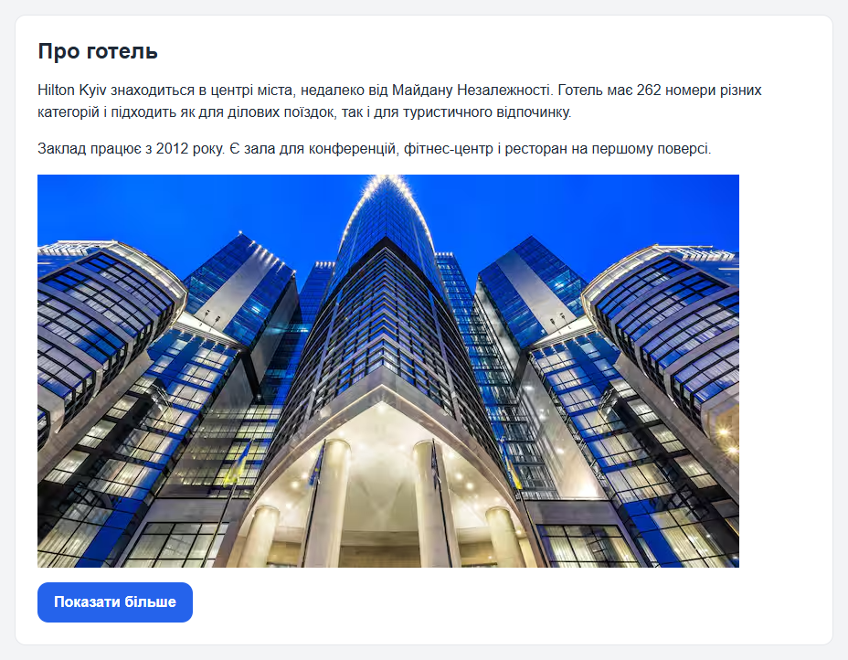
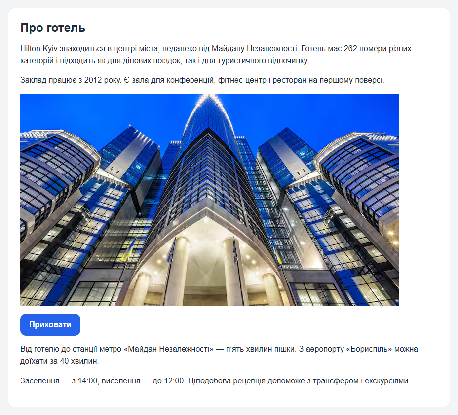
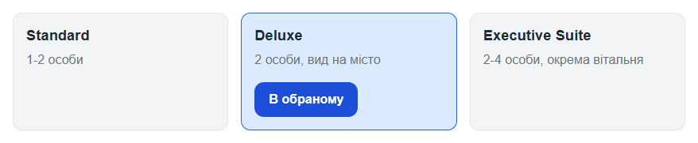
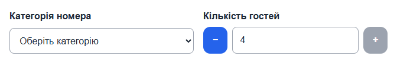
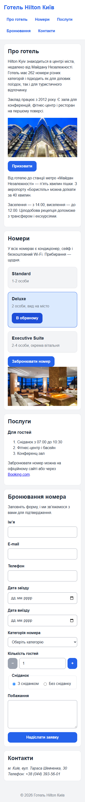
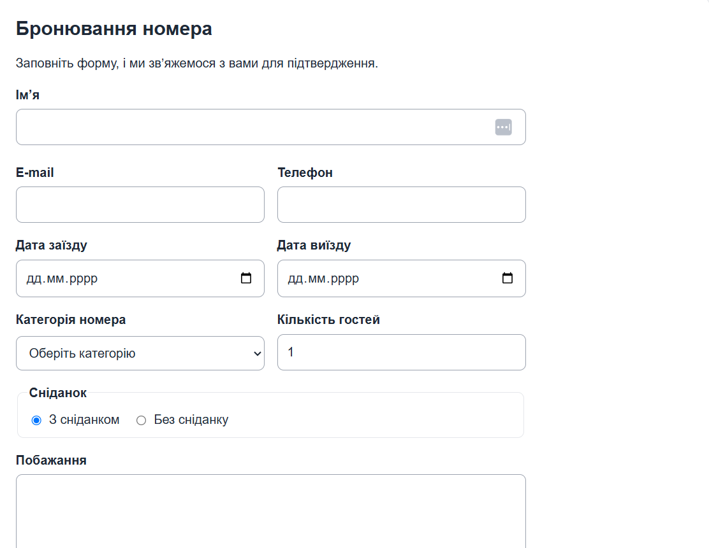

# Лабораторна робота №5

## Тема, мета та опис проєкту

Тема: основи JavaScript, взаємодія з DOM та подіями.

Мета: навчитися підключати зовнішній JavaScript-файл, знаходити наявні HTML-елементи, реагувати на дії користувача та змінювати класи й текстовий вміст елементів.

Опис проєкту: сайт готелю Hilton Київ (варіант 20) з лабораторних №1-4. Дизайн і структура не змінились, сторінка отримала три прості інтерактивні можливості.

## Реалізовані взаємодії

| Взаємодія | Що робить | Клас стану | ARIA |
| --- | --- | --- | --- |
| Показати більше | Кнопка в розділі «Про готель» відкриває і ховає додатковий блок, текст кнопки змінюється між «Показати більше» і «Приховати» | `is-hidden` | `aria-expanded`, `aria-controls` |
| Обране | Кнопка на картці Deluxe перемикає стан «Додати в обране» / «В обраному», кнопка і картка підсвічуються | `is-active` | `aria-pressed` |
| Лічильник гостей | Кнопки «−» і «+» біля поля кількості гостей у формі змінюють значення від 1 до 4, на межі кнопка стає неактивною | `disabled` | `aria-label` |

Усі кнопки мають `type="button"`, тому не надсилають форму. Вигляд змінюється лише через CSS-класи, inline-стилі в JavaScript не використовуються. Збереження після перезавантаження не потрібне і не реалізоване.

## Використані DOM-методи та події

- `document.querySelector()`: пошук кнопок, блоку і поля форми.
- `element.closest()`: пошук картки, у якій лежить кнопка «Обране».
- `addEventListener("click", ...)` для кнопок і `addEventListener("input", ...)` для поля кількості гостей.
- `classList.toggle()`: перемикання `is-hidden` та `is-active`.
- `textContent`: зміна тексту кнопок.
- `setAttribute()`: оновлення `aria-expanded` і `aria-pressed`.

Скрипт знаходиться в `js/main.js` і підключений у кінці `index.html` з атрибутом `defer`.

## Структура проєкту

```
lab1-hotel/
├── css/
│   └── styles.css
├── images/
├── js/
│   └── main.js
├── scss/
├── index.html
└── README.md
```

## Скриншоти

Показати більше: закритий і відкритий стан:





Обране:



Лічильник гостей (максимум 4, кнопка «+» неактивна):



Мобільна ширина 360 px:



## Результати перевірки

- У Console немає помилок і попереджень від мого коду.
- Кожна дія працює після повторних натискань і повертається у початковий стан.
- Кнопки доступні з клавіатури (Tab, Enter, пробіл), рамка фокуса `:focus-visible` залишилась.
- `aria-expanded` і `aria-pressed` відповідають фактичному стану.
- На ширинах 360 і 768 px горизонтального прокручування немає, взаємодії працюють.

## Посилання та висновок

Pull request: https://github.com/NazariiKhavruk/lab1-hotel/pull/3

Висновок: у цій роботі я навчився підключати зовнішній скрипт з `defer`, знаходити елементи через `querySelector()`, обробляти події через `addEventListener()` та змінювати інтерфейс через `classList` і `textContent`. Також побачив, навіщо кнопкам `aria-expanded` і `aria-pressed`. Практикувався з Git: окремі коміти за форматом `type: description`.

---

# Лабораторна робота №4

## Тема, мета та опис проєкту

Тема: препроцесор SCSS та адаптивний дизайн веб-сторінки.

Мета: навчитися організовувати стилі в SCSS (змінні, вкладеність, міксини, модулі), компілювати їх у CSS і зробити так, щоб сторінка добре виглядала на телефоні, планшеті та комп'ютері.

Опис проєкту: сайт готелю Hilton Київ (варіант 20) з лабораторних №1-3. HTML, картки та форма залишились без змін, я переніс стилі в SCSS і додав адаптивність.

## Структура SCSS

```
scss/
├── _variables.scss
├── _mixins.scss
└── main.scss
```

- `_variables.scss`: змінні для кольорів (`$color-primary`, `$color-text`, `$color-border` та інші), відступів (`$space-md`, `$space-lg`), заокруглень (`$radius-sm`, `$radius-md`) і точок переходу (`$bp-tablet`, `$bp-desktop`).
- `_mixins.scss`: міксин `respond-from($breakpoint)` з параметром, який обгортає стилі в `@media (min-width: ...)`, і міксин `focus-ring` для видимої рамки фокуса.
- `main.scss`: усі стилі сторінки. Файли підключені через `@use "variables" as v;` та `@use "mixins" as m;`, без `@import`.
- Вкладеність використана в `.main-nav` (посилання `a` зі станами `&:hover` і `&:focus-visible`), `.site-header`, `.button`, `.form-field` та інших компонентах. Глибше двох рівнів не вкладав.

## Команди

Встановити залежності (один раз):

```
npm install
```

Скомпілювати SCSS у CSS і стежити за змінами:

```
npm run sass
```

Одноразова збірка:

```
npm run build
```

Результат записується в `css/styles.css`, який підключений в `index.html`. Скомпільований CSS вручну я не редагував.

## Mobile-first і точки переходу

Базові стилі написані для малого екрана, потім `min-width` поступово розширює макет:

| Точка | Ширина | Що змінюється |
| --- | --- | --- |
| базові стилі | до 768 px | картки в одну колонку, шапка стовпчиком, поля форми одне під одним, менші відступи |
| `$bp-tablet` | від 48rem (768 px) | картки в 2 колонки, шапка в один рядок, поля форми по два в ряд, відступи більші |
| `$bp-desktop` | від 64rem (1024 px) | картки в 3 колонки |

На великих екранах ширина контенту обмежена (`max-width: 60rem`). Точки вибрав за стандартом 768 і 1024 px, бо на цих ширинах картки і форма перестають зручно вміщатися в поточну кількість колонок.

## Скриншоти

360 px:


768 px:


1280 px:


## Результати перевірки

- На ширинах 360, 768 і 1280 px горизонтального прокручування немає (перевірив у DevTools).
- Картки: 1 колонка на 360 px, 2 на 768 px, 3 на 1280 px.
- Меню переноситься на малому екрані, поля форми займають всю ширину.
- Форма працює як раніше: обов'язкові поля, перевірка e-mail, телефона та кількості гостей.
- Навігацію і форму пройшов клавішею Tab: рамка фокуса видима.

## Посилання та висновок

Pull request: (посилання буде після створення)

Висновок: у цій роботі я навчився користуватись SCSS: змінними, вкладеністю, міксинами та поділом на файли. Також навчився компілювати SCSS у CSS і робити адаптивний макет за підходом mobile-first. Практикувався з Git: окремі коміти за форматом `type: description`.

---

# Лабораторна робота №3

## Тема, мета та опис проєкту

Тема: компонування веб-сторінки засобами CSS Flexbox і Grid, створення HTML-форми.

Мета: навчитися вибирати Flexbox або Grid для розміщення елементів, керувати вирівнюванням і проміжками, зробити форму з підписами та вбудованою HTML-перевіркою.

Опис проєкту: сайт готелю Hilton Київ (варіант 20) з лабораторних №1 і №2. Тут я покращив розміщення блоків і додав форму бронювання номера.

## Компонування сторінки

- Flexbox використано для шапки (назва зліва, меню справа, `justify-content: space-between`), для меню (`flex-wrap` і `gap`) та для групи радіокнопок у формі. У всіх трьох випадках елементи йдуть в один ряд, тому Flexbox підходить краще.
- Grid використано для карток номерів: `grid-template-columns: repeat(3, minmax(0, 1fr))` і `gap`. Також Grid використано для самої форми і для рядків з двома полями поруч (дати, e-mail і телефон, категорія і кількість гостей).
- Медіазапити, SCSS і JavaScript не використовувались.

## Форма та перевірка даних

Форма бронювання має такі поля, у кожного є `id`, `name` і `label` з `for`:

| Поле | Тип | Правила перевірки |
| --- | --- | --- |
| Ім’я | text | `required`, `minlength="2"` |
| E-mail | email | `required`, перевірка формату |
| Телефон | tel | `required`, `pattern` |
| Дата заїзду та виїзду | date | `required` |
| Категорія номера | select | `required` |
| Кількість гостей | number | `required`, `min="1"`, `max="4"` |
| Сніданок | radio у `fieldset` з `legend` | вибір за замовчуванням |
| Побажання | textarea | `maxlength="500"` |

Стани: у кнопки є `:hover`, у всіх полів `:focus-visible` з помітною рамкою, а поля з помилкою під час введення отримують червону рамку через `:focus:invalid`.

## Структура проєкту

```
lab1-hotel/
├── css/
│   └── styles.css
├── images/
├── index.html
└── README.md
```

## Результат



## Посилання та висновок

Pull request: (посилання буде після створення)

Висновок: у цій роботі я навчився використовувати Flexbox для рядків і Grid для сіток та форми, зробив форму з підписами та HTML-перевіркою і перевірив її клавішею Tab. Також практикувався з Git: окремі коміти за формат `type: description`.
